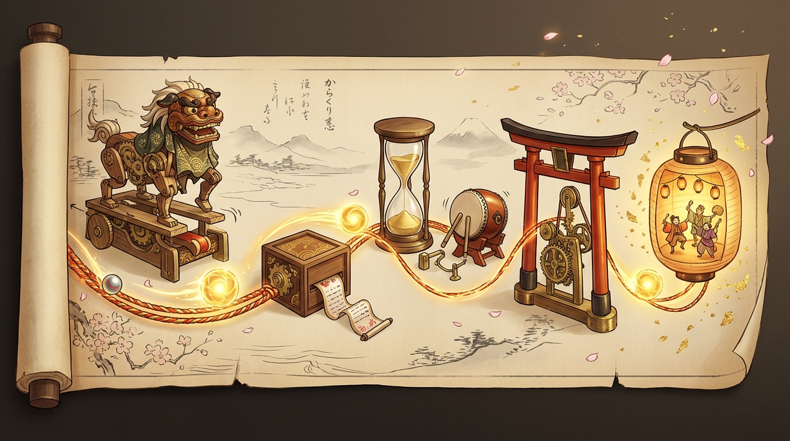
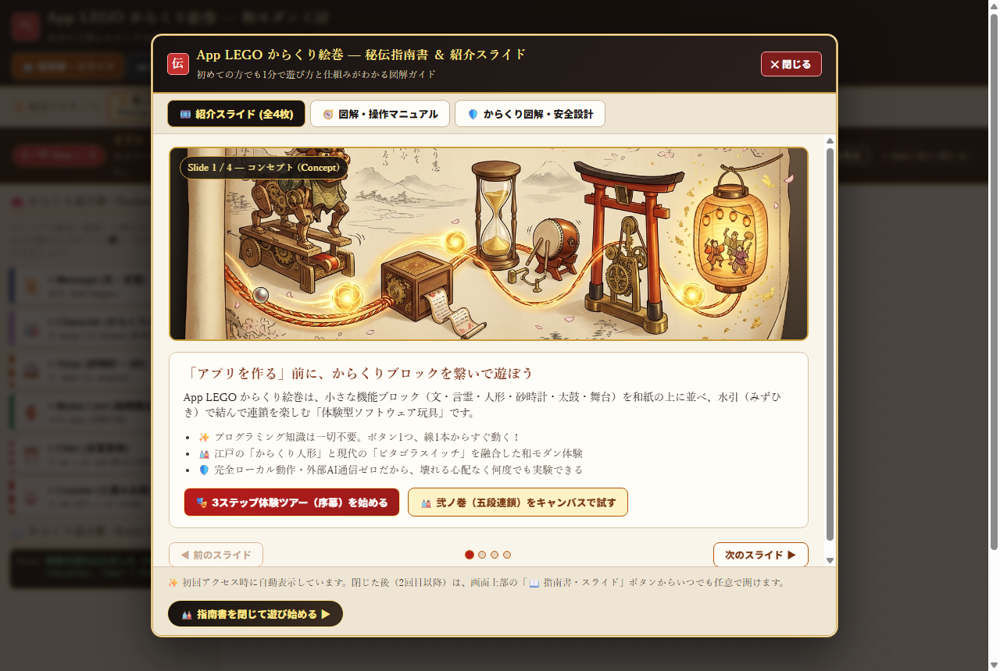
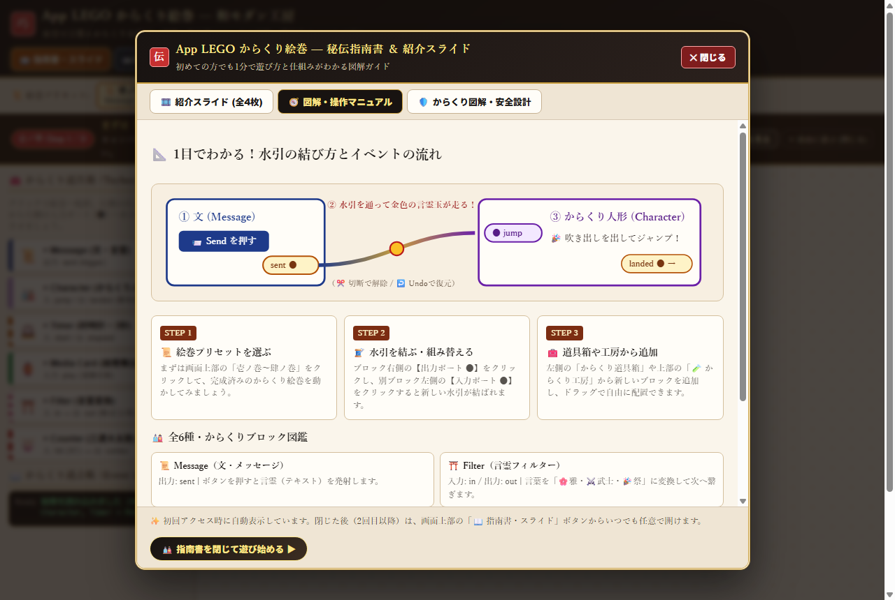
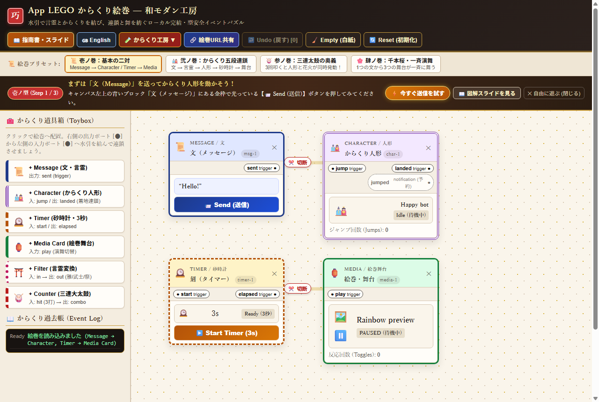
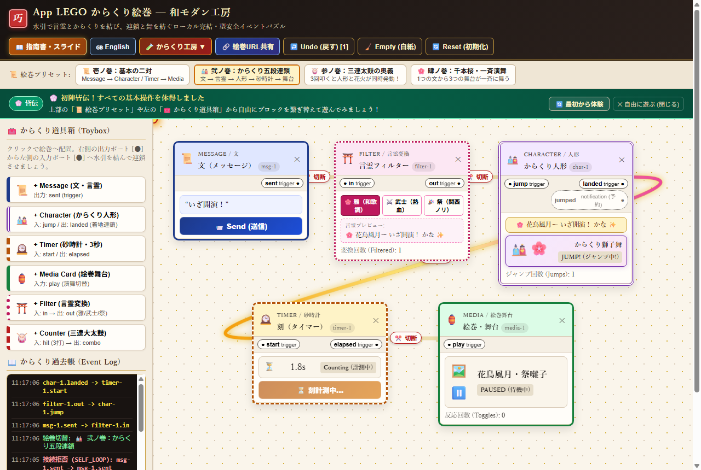
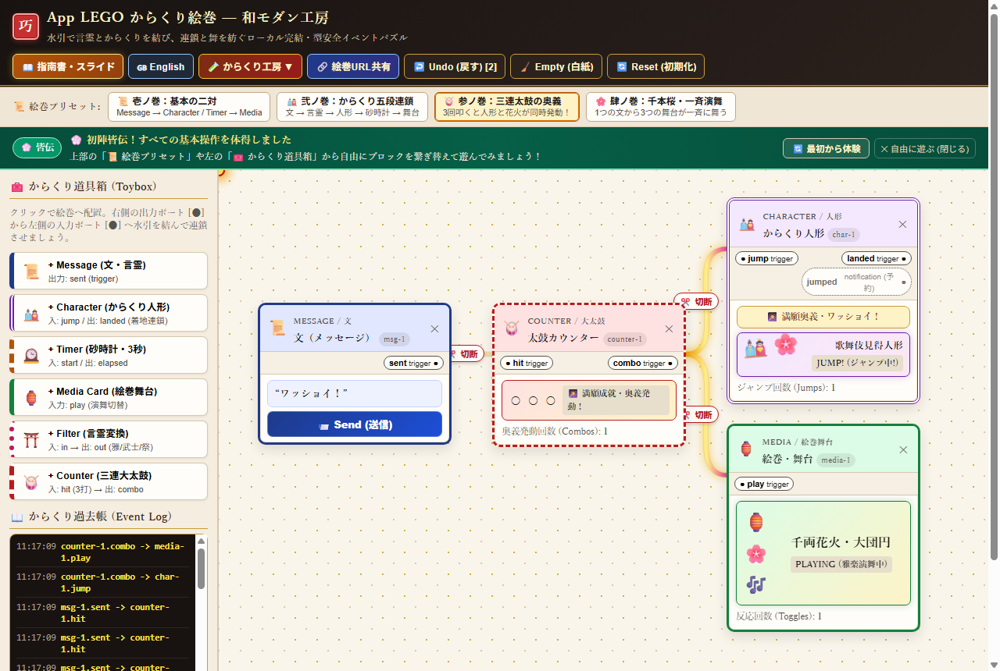
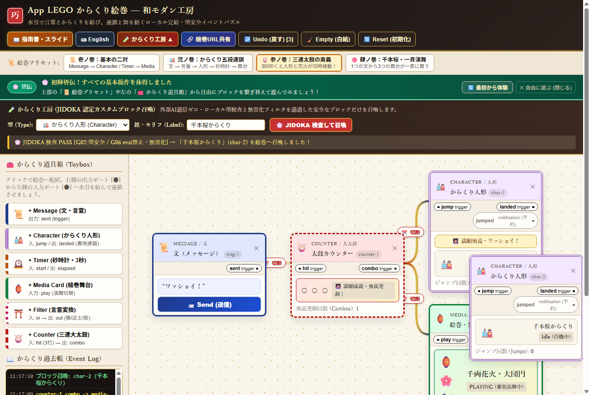
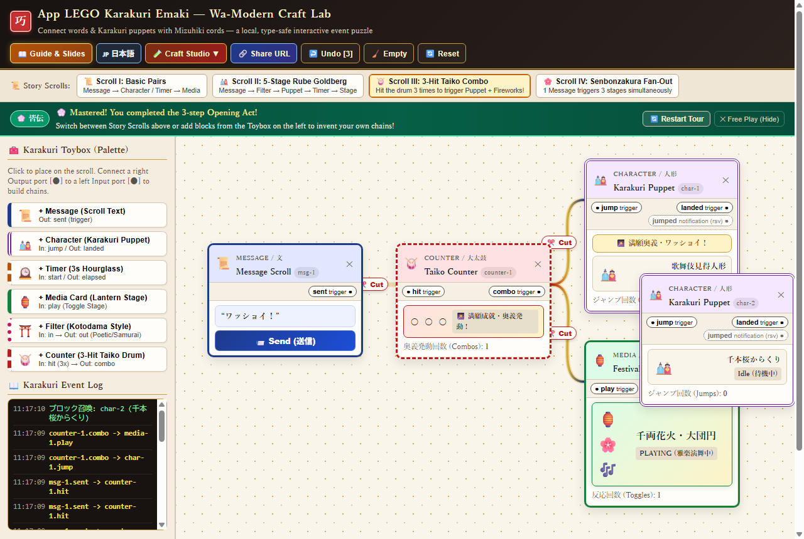
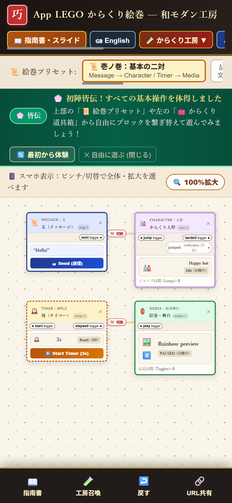

# App LEGO Lab — ソフトウェアをブロックのように組み合わせて遊ぶ (PoC 0 & PoC 1 和モダン・からくり絵巻)

<p align="center">
  <a href="https://kentaro-oishi-c3creators.github.io/app-lego-lab/">
    
  </a>
</p>

## 🌐 公開デモサイト (GitHub Pages)

👉 **[今すぐブラウザで体験する：https://kentaro-oishi-c3creators.github.io/app-lego-lab/](https://kentaro-oishi-c3creators.github.io/app-lego-lab/)**

- **インストール不要・完全ローカル実行**：ブラウザだけでそのまま遊べます（PC・スマートフォン両対応 / 日本語・英語モード切替対応）。
- **初回アクセス時の「秘伝指南書 & 紹介スライド」**：初めて開くとコンセプト紹介スライド（全4枚）と図解操作マニュアルが自動表示されます（2回目以降は上部または下部ナビの **「📖 指南書・スライド」** からいつでも開けます）。
- **直感的な「🎭 序幕：3ステップ体験ツアー」**：画面上部のガイドに従ってボタンを押すだけで、「文を送る → 人形が跳ぶ → 水引を切る → 元に戻す（Undo）」を30秒で体感できます。

---

**ステータス: PoC 0 完了 ＋ PoC 1「全部入り・和モダンからくり絵巻」実装・公開完了（ローカル実行・決定論的イベントグラフ）**
2026-10-31 / 2026-11-01 Antigravity Deep Dive ハッカソン向けに実装・検証済み。

> Connect. Play. Break. Remix. **水引で言霊とからくりを結び、連鎖と舞を紡ぐローカル完結・型安全イベントパズル。**

本リポジトリは、小さなアプリ風ブロックを組み合わせて遊ぶプライバシー安全な実験用 PoC（PoC 0 / PoC 1）です。LEGO、LINE、YouTube 等のクローンではありません。`App LEGO` はプロジェクト内部の仮称（Working nickname）です。

---

## 🖼️ 画面ギャラリー (Screenshots & Visual Guide)

### 1. 初回起動時の「秘伝指南書 & 紹介スライド」と図解マニュアル

| 🎬 紹介スライド（全4枚・初回自動表示） | 🧭 SVG図解・操作マニュアル & 6種ブロック一覧 |
| :---: | :---: |
|  |  |
| コンセプトアートと共に「なぜブロックを繋いで遊ぶのか」を4枚のスライドで直感的に紹介。モーダル内からワンクリックで体験ツアーや五段連鎖を開始できます。 | 「①送信 → ②水引を伝う → ③人形が跳ぶ → ④切ってUndo」の4ステップSVG図解と、全6種のブロックの役割・ポート仕様をひと目で確認できます。 |

### 2. 和モダン・からくり絵巻キャンバス & 多段ピタゴラ連鎖

| 📜 壱ノ巻（デスクトップ全体 & 3ステップ体験ツアー） | 🎎 弐ノ巻（五段ピタゴラ連鎖 & 言霊吹き出し） |
| :---: | :---: |
|  |  |
| 漆塗りと金箔・生成り和紙を基調とした「和モダン・からくり絵巻」UI。上部の3ステップ体験ツアー（序幕）に沿って実際に触りながら操作を覚えられます。 | `Message → 言霊Filter → Character(着地) → Timer → MediaCard` の5段連鎖。水引の上を金色の言霊玉が走り、人形の頭上に変換された言霊（「雅」「武士」「祭」）が吹き出しで浮かび上がります。 |

### 3. 三連太鼓コンボ・からくり工房・英語モード・スマホ対応

| 🥁 参ノ巻（三連太鼓コンボ & 花火演舞） | 🧪 からくり工房（JIDOKA 認定カスタム召喚） |
| :---: | :---: |
|  |  |
| 太鼓カウンターが3回叩かれると「満願成就」となり、`combo` 出力からからくり人形と絵巻舞台（花火・雅楽）を同時発動させます。 | 外部AI通信ゼロ・ローカル型検査と無害化フィルタを通過したカスタムブロックを `JIDOKA PASS` 証跡付きで絵巻へ召喚できます。 |

| 🌐 英語モード (Full English UI Toggle) | 📱 スマートフォン対応 (自動フィット & 下部ナビ) |
| :---: | :---: |
|  |  |
| ヘッダーの **「🌐 English / 日本語」** ボタンで、ブロック・ポート・プリセット・指南書・体験ツアーまで全UIを即座に英語／日本語へ切り替えられます。 | スマホ画面でも絵巻全体が自動で縮小フィットし、下部の専用ナビバー（巻物切替・ブロック追加・指南書）とタッチ操作で快適に遊べます。 |

---

## 1文で表す実験内容 (One-sentence experiment)

初めてのユーザーが説明なしでトイブロック（文・言霊フィルター・太鼓カウンター・からくり人形・砂時計・絵巻舞台）を配置・水引で結線し、多段ピタゴラ連鎖や言霊吹き出しの驚きを観察し、線を切って反応が止まることを確かめ、Undo（元に戻す）やURLハッシュで自在に復元・共有できるか？

**PoC 0 / PoC 1** は実行時に完全オフライン・決定論的に動作します。実行時の LLM/AI API 呼び出し、アカウント認証、クラウド保存、外部通信、課金、実データの取り込み、任意コード実行（`eval` 等）は一切行いません。

---

## クイックスタート & コマンド一覧

Node.js (v20+ / v22推奨) 環境で以下のコマンドを実行できます。

```bash
# 1. 依存パッケージのインストール
npm install

# 2. ローカル開発サーバーの起動 (http://localhost:5173)
npm run dev

# 3. TypeScript 型チェック (strict: true)
npm run typecheck

# 4. 自動テストの実行 (Vitest: グラフ検証・有界ディスパッチ・Undo・UI統合テスト 26件)
npm test

# 5. 本番ビルドの検証 (tsc --noEmit && vite build)
npm run build
```

---

## デモ操作手順 (Demo Steps)

1. **起動と初期サンプル確認**：[公開デモサイト (GitHub Pages)](https://kentaro-oishi-c3creators.github.io/app-lego-lab/) または `npm run dev` でブラウザを開くと、初回は「秘伝指南書 & 紹介スライド」が表示されます。閉じると、`Message → Character` と `Timer → Media Card` が水引で結ばれた初期絵巻（📜 壱ノ巻）が表示されます。
2. **Message → Character の動作確認**：`Message (msg-1)` ブロックの **「📨 Send (送信)」** ボタンを押すと、`sent → jump` の水引を通って金色の言霊玉が走り、`Character (char-1)` がジャンプして頭上に吹き出しが表示され、下部の **からくり過去帳 (Event Log)** に `msg-1.sent -> char-1.jump` が記録されます。
3. **切断 (Disconnect)**：キャンバス上の水引にある **「✂️ 切断」** ボタン（または画面下部バーの **「切断」** ボタン）を押してから **「📨 Send (送信)」** を押すと、Character はジャンプせず、過去帳に `unhandled`（未接続）と記録されます。
4. **元に戻す (Undo)**：上部ツールバーの **「↩️ Undo (戻す)」** を押すと水引が復元され、再度 **「📨 Send (送信)」** を押すと Character が再びジャンプします。
5. **Timer → Media Card の動作確認**：`Timer (timer-1)` の **「▶️ Start Timer (3s)」** を押すと、カウントダウン後に `elapsed` イベントが1回だけ発火し、`Media Card (media-1)` のモック演舞状態（`PLAYING` / `PAUSED`）が切り替わります。カウントダウン中に Timer ブロックを削除（`✕`）するとタイマーは安全にクリーンアップされ、発火しません。
6. **PoC 1 新機能（全部入り・和モダンからくり絵巻）**：
   - **📜 4種の絵巻プリセット**：上部バーから **「📜 壱ノ巻：基本の二対」「🎎 弐ノ巻：からくり五段連鎖」「🥁 参ノ巻：三連太鼓の奥義」「🌸 肆ノ巻：千本桜・一斉演舞」** をワンクリックで切り替えられます。
   - **🎎 五段ピタゴラ連鎖 & 金色の言霊玉アニメーション**：`Message.sent → Filter.in/out → Character.jump/landed → Timer.start/elapsed → MediaCard.play` の5段連鎖が繋がり、水引の曲線上を金色の言霊玉（`kotodama-orb`）が走ります。
   - **⛩️ 言霊フィルター (`filter`) & 吹き出し表示**：文（メッセージ）を「🌸 雅（和歌調）」「⚔️ 武士（熱血）」「🎉 祭（関西ノリ）」に変換し、からくり人形の頭上に吹き出しとして表示します。
   - **🥁 太鼓カウンター (`counter`)**：指定回数（デフォルト3回）叩かれると満願成就となり、`combo` 出力から人形と花火舞台を同時発動させます。
   - **🧪 からくり工房（JIDOKA 認定カスタムブロック召喚）**：外部AI通信ゼロ・ローカル型検査と無害化フィルタを通過したカスタムブロックを `JIDOKA PASS` 証跡付きで絵巻へ召喚できます。
   - **🔗 絵巻URL共有 (`#emaki=...`)**：現在の絵巻を Base64URL ハッシュに変換してサーバーレスで共有・復元できます（復元時も `sanitizeGraph` で無害化）。
7. **不正な接続の拒否 (Poka-yoke)**：
   - 同じブロックのポート同士（自己ループ：`msg-1.sent -> msg-1.sent`）
   - 出力ポート同士（`msg-1.sent -> timer-1.elapsed`）や入力ポート同士（`char-1.jump -> media-1.play`）
   - 予約済み・未対応ポート（`char-1.jumped [notification] -> media-1.play`）
   - 閉路（サイクル）や重複接続
   を試みると、上部にわかりやすい警告バナーが表示され、グラフ構造は一切変更されません。
8. **組み替え・白紙・リセット**：
   - **「🧹 Empty (白紙)」** でゼロからブロックを配置でき、**「🔄 Reset (初期化)」** でいつでも初期サンプルに戻せます。

---

## 設計上の制限事項 (Known Limitations)

- **安全な6種のブロック型のみ**：ブロック種別は `message`, `character`, `timer`, `media-card`, `filter`, `counter` の6種のみです。任意のJavaScript実行や外部通信は一切行いません。
- **予約ポート (`Character.jumped: notification`)**：将来構想のアイデアおよび未対応型テスト（G02）のためUI上に点線（予約）として表示しており、接続を試みると未対応イベント型（`UNSUPPORTED_PORT_TYPE`）として安全に拒否されます。一方、着地連鎖には有効な `Character.landed: trigger` ポートを使用します。
- **Undo履歴**：グラフ構造（ノードの追加・削除・移動完了時の座標・設定変更、エッジの接続・切断、プリセット切替、白紙化）のスナップショットを最大30件保持します。
- **メディア再生**：`Media Card` はCSSによる視覚的モック（雅楽・花火演舞アニメーション）であり、実際の音声・動画ストリームは再生しません。

---

## プロジェクト構成 (Project Layout)

```text
AGENTS.md                   エージェント作業ルールと厳格な安全境界
assets/                     README埋め込み用のコンセプトアート・画面スクリーンショット一式
public/                     Vite配信用の静的アセット（コンセプトヒーロー画など）
.agents/agents/             Antigravity サブエージェント定義 (Graph / UI / JIDOKA Inspector)
.agents/skills/             ワークスペース Skills (app-lego-poc, jidoka-inspector, factory-learning)
docs/01_PRD.md              プロダクト仕様書・受け入れシナリオ
docs/02_TASK_CONTRACT.md    タスク契約書（目標・非目標・制約・完了条件）
docs/03_ARCHITECTURE.md     型付きイベントグラフ・有界ランタイム設計
docs/04_JIDOKA_POLICY.md    JIDOKA ブロッキング品質ゲート (G01–G07)
docs/05_RUNBOOK.md          ハッカソン実行ランブック
docs/06_MODEL_COMPARISON.md モデル・エージェント横断比較実験計画
docs/07_PROVENANCE.md       出典・プライバシー境界・名称に関する注意
docs/08_SELF_IMPROVING_FACTORY.md 自己改善型 JIDOKA Factory の原則
docs/09_MULTI_AGENT_HANDOFF.md    Antigravity / Codex / Claude / Kiro 横断レビュー契約
fixtures/sample-story.json  初期サンプルグラフデータ（架空データのみ）
src/domain/                 純粋関数による型付きグラフ検証・言霊変換・多言語辞書・URL共有・有界イベント配送
src/state/history.ts        決定論的スナップショットによる Undo 履歴管理
src/components/             6種のブロック・秘伝指南書モーダル・和紙水引インタラクティブ Canvas
src/app/App.tsx             パレット・3ステップ序幕ツアー・プリセット巻物・からくり工房・多段連鎖RuntimeDriver統合
tests/                      単体テストおよび React UI 統合テスト (全26件 / G02–G05)
experiments/                実行ごとの再現可能な実験・検査記録 (poc0 / poc1)
artifacts/                  スクリーンショット・テストログ等の証跡
```

## プライバシー・安全性の分離

個人の自己分析プロジェクトや社外秘・顧客データは一切含めていません。すべてのラベル・テキストは架空のサンプルデータです。
